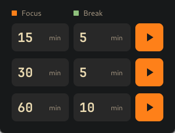
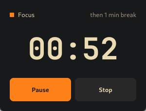
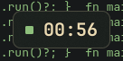

# tomat

Three focus/break slots, and a timer that stays on screen. Nothing more: no tracking, no counts, no history. *Tomat* is "tomato" in Danish, Norwegian and Swedish.

 



## Use

1. Open **tomat**, fill a slot and press play. The window closes.
2. A small piece of frosted glass shows the time over everything, fullscreen apps too. Clicks pass through it. Orange is focus, green is a break, yellow is paused.
3. Open tomat again to pause or stop. While it is open you can also drag the glass.

Focus and break alternate until you press Stop. The glass follows KDE between dark and light.

| Key, in the window | Does |
|---|---|
| `Tab` | Next field or button |
| `Enter` in a field | Start that slot |
| `Space` | Pause or resume |
| `Esc` | Close the window (the timer keeps going) |

## Needs

KDE Plasma 6 on Wayland is what it's built and tested for. The glass needs the layer-shell protocol, which GNOME doesn't have. The frost needs KWin's Blur effect: without it the glass is nearly solid.

## Install

```sh
mise run install              # for you only: menu entry, icon, ~/.local/bin/tomat
scripts/install.sh --uninstall
```

[mise](https://mise.jdx.dev) installs the pinned Rust on first use.

## What it saves

Only on your PC: the three slots, where you put the glass, the running timer until you press Stop (so a crash doesn't lose it), and 7 days of logs of what went wrong. The logs never say when a timer started, finished or how long it was. See [docs/data.md](docs/data.md).

It uses about 1 MB of RAM while a timer runs. The window adds about 17 MB, only while it is open.

## Develop

```sh
mise run check    # format, lints (pedantic), tests
mise run build    # both programs
mise run glass    # preview the glass alone
```

- [docs/architecture.md](docs/architecture.md): how the parts fit together
- [docs/codebase-map.md](docs/codebase-map.md): what each file does
- [docs/decisions.md](docs/decisions.md): why it's built this way
- [docs/data.md](docs/data.md): every file it writes
- [docs/operations.md](docs/operations.md): logs and fixes

## License

MIT, see [LICENSE](LICENSE). The digit font is under the SIL Open Font License ([text](assets/LICENSE-digits.txt)).

The window is built with [Slint](https://slint.dev), used under its Royalty-free Desktop, Mobile, and Web Applications License.

[](https://slint.dev)
