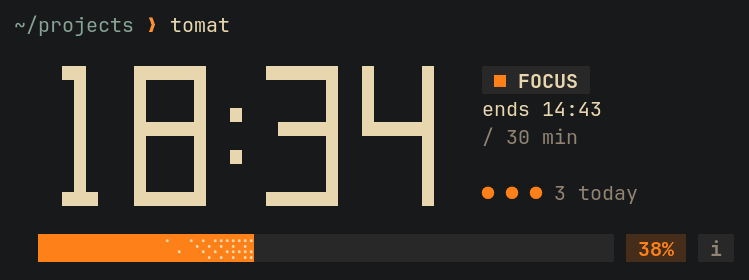
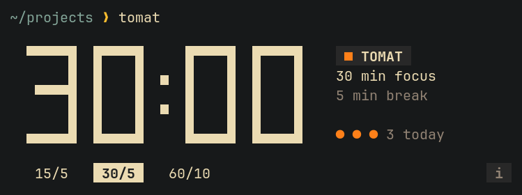

# tomat

A plain pomodoro timer for the terminal: focus, break, focus, break. It draws a small block under your prompt, uses your terminal's own background, and runs in under 1 MiB of memory. *Tomat* is "tomato" in Danish, Norwegian and Swedish.



The progress bar is a solid streak with a layer of sparkles at its front, drifting while the timer runs. Orange means focus, aqua means a break, and yellow means paused. The orange dots count today's finished focus sessions.



## Install

```sh
mise run install          # static musl build, under 1 MiB of RAM
mise run install-glibc    # the usual dynamic build (about 2.6 MiB RSS)
```

[mise](https://mise.jdx.dev) installs the pinned Rust toolchain (1.99.1, with the musl target) on first use. Without mise, rustup does the same from `rust-toolchain.toml`, and plain `cargo install --locked --path .` works too (Rust 1.88 or newer). Desktop notifications use `notify-send` (libnotify, included with GNOME and most Linux desktops); without it, only the terminal bell rings.

## Use

```sh
tomat                  # menu: 15/5, 30/5 or 60/10
tomat -w 45 -b 10      # start 45 min focus / 10 min break right away
tomat --auto           # start each next phase without waiting for Enter
tomat --help
```

The keys stay hidden until you press `i` (the chip at the end of the presets or progress row):

| Key | Does |
|---|---|
| `h` `l` / `←` `→`, `enter`, `1`-`9` | Pick a preset in the menu (`j` `k` work too) |
| `space` / `p` | Pause or resume |
| `enter` | Start the next phase when it is waiting |
| `s` | Skip to the next phase (a skipped focus is not counted) |
| `r` | Restart the current phase |
| `m` / `esc` | Back to the menu |
| `i` / `?` | Show or hide the keys |
| `q` / `ctrl-c` | Quit (the block disappears and leaves your prompt clean) |

Each finished focus session is added to `~/.local/share/tomat/log.csv`. See [docs/data.md](docs/data.md).

## Develop

```sh
mise run check    # fmt check, clippy (pedantic, warnings are errors), tests
mise run run      # 3-second phases, kept out of your real history
mise tasks        # list every task
```

The code is in three parts: `src/pomodoro/` (pure logic), `src/tui/` (the terminal) and `src/system/` (notifications, history), wired together in `src/main.rs`.

- [docs/architecture.md](docs/architecture.md): how the parts fit together
- [docs/codebase-map.md](docs/codebase-map.md): what each file does, and where to change things
- [docs/decisions.md](docs/decisions.md): why it's built this way, with the memory measurements
- [docs/data.md](docs/data.md): the history file

## License

MIT, see [LICENSE](LICENSE).
